# BDF Lab 3 – REST API, Query Parameters, Validation & Debugging

## Student Details
- **Name:** Potnuru Dilleswara Rao
- **Registration Number:** 252U1R1198
- **Class & Section:** CSE-2D
- **Study Level:** UG (Year II / Term II)
- **Course:** Backend Development Fundamentals (BDF)
- **Assessment:** Lab 3 – REST API, Query Parameters, Validation & Debugging

---

## Submission & Deployment Links
- **GitHub Repository:** [https://github.com/dilleswararao34/BDF-LAB-3](https://github.com/dilleswararao34/BDF-LAB-3)
- **Live Deployment URL (Render):** [https://bdf-lab-3-gzkh.onrender.com](https://bdf-lab-3-gzkh.onrender.com)
- **Live API Endpoint:** [https://bdf-lab-3-gzkh.onrender.com/books/](https://bdf-lab-3-gzkh.onrender.com/books/)
- **Live Health Check:** [https://bdf-lab-3-gzkh.onrender.com/](https://bdf-lab-3-gzkh.onrender.com/)

---

## Project Overview
This project implements a complete, robust, and clean RESTful API for a Book Store management system built using **Node.js**, **Express.js**, and **SQLite**. It satisfies all requirements of **Lab 3: REST API, Query Parameters, Validation & Debugging**, featuring:

- **Resource-based REST endpoints** for complete CRUD operations on books (`GET`, `POST`, `PUT`, `DELETE`).
- **Comprehensive Query Parameter support** on `GET /books/`:
  - Partial title search using SQL `LIKE` with wildcards (`search_q`).
  - Column sorting with strict whitelist validation (`order_by`).
  - Sort direction (`order=ASC` and `order=DESC`).
  - Pagination (`limit` and `offset`).
  - Price-range filtering using SQL `BETWEEN` or comparison operators (`min_price` and `max_price`).
  - Seamless interoperability when combining search, sorting, pagination, and price filters in a single query.
- **Strict Request Body Validation** on `POST /books/` and `PUT /books/:bookId/` rejecting missing titles, missing authors, missing prices, or non-numeric/negative prices with HTTP `400 Bad Request`.
- **Standardized HTTP status codes** (`200 OK`, `201 Created`, `400 Bad Request`, `404 Not Found`, `500 Internal Server Error`) with consistent JSON responses.
- **Safe SQL Parameterization** using `?` placeholders across all queries to prevent SQL Injection attacks.
- **Automatic Database Initialization** that creates the schema and seeds 10 sample books automatically on application startup whenever the table is empty.
- **In-depth Debugging Documentation** in `DEBUGGING.md` analyzing and solving four major backend errors (`EADDRINUSE`, wrong import path, `no such table`, and missing `await`).
- **Automated Verification Suite** (`npm test`) executing 25 unit/integration test cases, plus a complete Postman v2.1.0 collection.

---

## Technologies Used
- **Runtime:** Node.js (v18+)
- **Web Framework:** Express.js (`^4.21.2`)
- **Database Engine:** SQLite3 (`^5.1.7`)
- **Database Client / Wrapper:** `sqlite` (`^5.1.1`) (Promise-based async/await wrapper)
- **Dev Tool:** Nodemon (`^3.1.9`) (Hot-reloads server upon code changes)
- **API Testing:** Native `fetch` automated test suite and Postman Collection v2.1.0

---

## Project Structure
```text
BDF-LAB-3/
├── .gitignore
├── DEBUGGING.md
├── index.js
├── initDb.js
├── package.json
├── package-lock.json
├── README.md
├── testEndpoints.js
├── postman/
│   └── BDF_LAB_3.postman_collection.json
└── screenshots/
    ├── README.md
    ├── 01_get_all_books.png.png
    ├── 02_search_books.png.png
    ├── 03_sort_ascending.png.png
    ├── 04_sort_descending.png.png
    ├── 05_pagination.png.png
    ├── 06_price_filter.png.png
    ├── 07_get_single_book.png.png
    ├── 08_add_book.png.png
    ├── 09_update_book.png.png
    ├── 10_delete_book.png.png
    ├── 11_validation_missing_title.png.png
    ├── 12_validation_missing_author.png.png
    ├── 13_validation_missing_price.png.png
    ├── 14_validation_invalid_price.png.png
    └── 15_book_not_found.png.png
```

---

## Installation & Setup

### 1. Prerequisites
Ensure **Node.js** (v18 or higher) and **npm** are installed on your machine:
```bash
node -v
npm -v
```

### 2. Clone and Install Dependencies
Clone the repository and install the required packages:
```bash
git clone https://github.com/dilleswararao34/BDF-LAB-3.git
cd BDF-LAB-3
npm install
```

### 3. Initialize / Seed the Database (Optional)
The application will automatically create `bookStore.db` and seed 10 sample books on first launch. If you wish to manually seed or reset the database at any time, run:
```bash
npm run init-db
```

### 4. Run the Application

**Production Mode:**
```bash
npm start
```

**Development Mode (with auto-reload via Nodemon):**
```bash
npm run dev
```

The server will start at:
`http://localhost:3000`

---

## REST API Endpoints Overview

| Method | Endpoint | Description | Expected Status |
| :--- | :--- | :--- | :--- |
| `GET` | `/` | API health check and overview | `200 OK` |
| `GET` | `/books/` | Retrieve books with optional search, sorting, pagination, and price range | `200 OK` / `400 Bad Request` |
| `GET` | `/books/:bookId/` | Retrieve a single book by its ID | `200 OK` / `400 Bad Request` / `404 Not Found` |
| `POST` | `/books/` | Create a new book record | `201 Created` / `400 Bad Request` |
| `PUT` | `/books/:bookId/` | Update an existing book record | `200 OK` / `400 Bad Request` / `404 Not Found` |
| `DELETE` | `/books/:bookId/` | Delete an existing book by ID | `200 OK` / `400 Bad Request` / `404 Not Found` |

---

## Detailed Endpoint Documentation

### 1. Root & Health Check
- **URL:** `GET /`
- **Response (`200 OK`):**
  ```json
  {
    "message": "Welcome to BDF Lab 3 Book Store API",
    "status": "Online",
    "endpoints": { ... }
  }
  ```

---

### 2. Retrieve Books – `GET /books/`
Fetches a list of books matching the specified query parameters.

#### Supported Query Parameters
| Parameter | Type | Default | Description & Validation |
| :--- | :--- | :--- | :--- |
| `search_q` | string | `""` | Partial search on `title` using SQL `LIKE %search_q%`. |
| `order_by` | string | `"id"` | Column to sort by. Allowed: `id`, `title`, `author`, `price`. Rejects invalid columns with `400`. |
| `order` | string | `"ASC"` | Sort direction. Allowed: `ASC`, `DESC` (case-insensitive). Rejects invalid values with `400`. |
| `limit` | integer | `10` | Maximum number of records to return. Must be a positive integer (> 0). Rejects non-integers or values <= 0 with `400`. |
| `offset` | integer | `0` | Number of records to skip. Must be a non-negative integer (>= 0). Rejects negative numbers with `400`. |
| `min_price` | number | *None* | Minimum price filter (`price >= min_price`). Must be non-negative. |
| `max_price` | number | *None* | Maximum price filter (`price <= max_price`). Must be non-negative. |

> **Note:** If both `min_price` and `max_price` are supplied, SQL `BETWEEN ? AND ?` is used. If `min_price > max_price`, HTTP `400 Bad Request` is returned.

#### Example Requests
1. **Get default first 10 books:**
   ```http
   GET /books/
   ```
2. **Search partial title:**
   ```http
   GET /books/?search_q=harry
   ```
3. **Sort by price descending:**
   ```http
   GET /books/?order_by=price&order=DESC
   ```
4. **Pagination (Page 2, 3 books per page):**
   ```http
   GET /books/?limit=3&offset=3
   ```
5. **Price-range filtering (books between ₹100 and ₹500):**
   ```http
   GET /books/?min_price=100&max_price=500
   ```
6. **Combined query:**
   ```http
   GET /books/?search_q=harry&order_by=price&order=DESC&limit=5&offset=0
   ```

#### Response (`200 OK`):
```json
[
  {
    "id": 2,
    "title": "Harry Potter and the Chamber of Secrets",
    "author": "J.K. Rowling",
    "price": 500
  },
  {
    "id": 1,
    "title": "Harry Potter and the Sorcerer's Stone",
    "author": "J.K. Rowling",
    "price": 450
  }
]
```

---

### 3. Retrieve a Book by ID – `GET /books/:bookId/`
- **URL:** `GET /books/1/`
- **Response (`200 OK`):**
  ```json
  {
    "id": 1,
    "title": "Harry Potter and the Sorcerer's Stone",
    "author": "J.K. Rowling",
    "price": 450
  }
  ```
- **Error Response (`404 Not Found`):**
  ```json
  {
    "message": "Book not found"
  }
  ```
- **Error Response (`400 Bad Request`):**
  ```json
  {
    "message": "Invalid book ID. Book ID must be a positive integer"
  }
  ```

---

### 4. Create a Book – `POST /books/`
- **URL:** `POST /books/`
- **Headers:** `Content-Type: application/json`
- **Request Body:**
  ```json
  {
    "title": "The Pragmatic Programmer",
    "author": "David Thomas",
    "price": 700
  }
  ```
- **Validation Rules:**
  - `title`: Required, non-empty string.
  - `author`: Required, non-empty string.
  - `price`: Required, numeric, non-negative.
- **Success Response (`201 Created`):**
  ```json
  {
    "message": "Book created successfully",
    "book": {
      "id": 11,
      "title": "The Pragmatic Programmer",
      "author": "David Thomas",
      "price": 700
    }
  }
  ```
- **Error Response (`400 Bad Request`):**
  ```json
  {
    "message": "Price must be a valid positive number"
  }
  ```

---

### 5. Update a Book – `PUT /books/:bookId/`
- **URL:** `PUT /books/1/`
- **Headers:** `Content-Type: application/json`
- **Request Body:**
  ```json
  {
    "title": "Harry Potter and the Sorcerer's Stone (Special Edition)",
    "author": "J.K. Rowling",
    "price": 550
  }
  ```
- **Success Response (`200 OK`):**
  ```json
  {
    "message": "Book updated successfully",
    "book": {
      "id": 1,
      "title": "Harry Potter and the Sorcerer's Stone (Special Edition)",
      "author": "J.K. Rowling",
      "price": 550
    }
  }
  ```
- **Error Response (`404 Not Found`):**
  ```json
  {
    "message": "Book not found"
  }
  ```

---

### 6. Delete a Book – `DELETE /books/:bookId/`
- **URL:** `DELETE /books/10/`
- **Success Response (`200 OK`):**
  ```json
  {
    "message": "Book deleted successfully"
  }
  ```
- **Error Response (`404 Not Found`):**
  ```json
  {
    "message": "Book not found"
  }
  ```

---

## Validation & HTTP Status Codes

| Status Code | Description | Scenario | Example Response |
| :--- | :--- | :--- | :--- |
| `200 OK` | Request Succeeded | Successful `GET`, `PUT`, or `DELETE` | `{ "message": "Book deleted successfully" }` |
| `201 Created` | Resource Created | Successful `POST /books/` | `{ "message": "Book created successfully", "book": { ... } }` |
| `400 Bad Request` | Input Validation Failed | Missing fields, non-numeric price, invalid column/direction/limit/offset | `{ "message": "Price must be a valid positive number" }` |
| `404 Not Found` | Resource Not Found | Querying, updating, or deleting a `bookId` that does not exist in SQLite | `{ "message": "Book not found" }` |
| `500 Internal Error`| Server Error | Unexpected database or uncaught runtime exception | `{ "message": "Internal server error" }` |

---

## Automated Verification Suite

An automated end-to-end test script is included to verify all 25 success and failure criteria without manual effort:

```bash
npm test
```

### Verified Test Cases:
1. `GET /` returns 200 OK and Online status.
2. `GET /books/` returns 200 OK and array of books.
3. `GET /books/?search_q=harry` filters partial title matches.
4. `GET /books/?order_by=price&order=ASC` sorts ascending.
5. `GET /books/?order_by=price&order=DESC` sorts descending.
6. `GET /books/?limit=3&offset=0` vs `offset=3` verifies non-overlapping pagination.
7. `GET /books/?min_price=100&max_price=500` filters price range correctly.
8. `GET /books/?search_q=harry&order_by=price&order=DESC&limit=5&offset=0` combines all query filters.
9. `GET /books/1/` retrieves single book by ID.
10. `POST /books/` inserts new record and returns 201 Created.
11. `PUT /books/:bookId/` updates existing record and returns 200 OK.
12. `DELETE /books/:bookId/` deletes record and returns 200 OK.
13. `POST /books/` missing title returns 400 Bad Request.
14. `POST /books/` missing author returns 400 Bad Request.
15. `POST /books/` missing price returns 400 Bad Request.
16. `POST /books/` non-numeric price returns 400 Bad Request.
17. `GET /books/99999/` returns 404 Not Found.
18. `PUT /books/99999/` returns 404 Not Found.
19. `DELETE /books/99999/` returns 404 Not Found.
20. `GET /books/?order_by=invalid_column` returns 400 Bad Request.
21. `GET /books/?order=HORIZONTAL` returns 400 Bad Request.
22. `GET /books/?limit=-5` returns 400 Bad Request.
23. `GET /books/?offset=-1` returns 400 Bad Request.
24. `GET /books/?min_price=abc` returns 400 Bad Request.
25. `GET /books/?min_price=500&max_price=200` returns 400 Bad Request.

---

## Testing with Postman

1. Open **Postman**.
2. Click **Import** in the top-left corner.
3. Select the file: `postman/BDF_LAB_3.postman_collection.json`.
4. Ensure your server is running locally:
   ```bash
   npm start
   ```
5. Run the individual requests or use the **Collection Runner** to execute all tests automatically against `http://localhost:3000`.

---

## Screenshots

The following 15 Postman test execution screenshots demonstrate all required CRUD endpoints, query parameter handling, price range filtering, and negative validation scenarios.

### 1. Successful Cases

#### 01. Get All Books (`GET /books/`)
- **Caption:** Retrieve all books from the SQLite database with default sorting and pagination (`200 OK`).
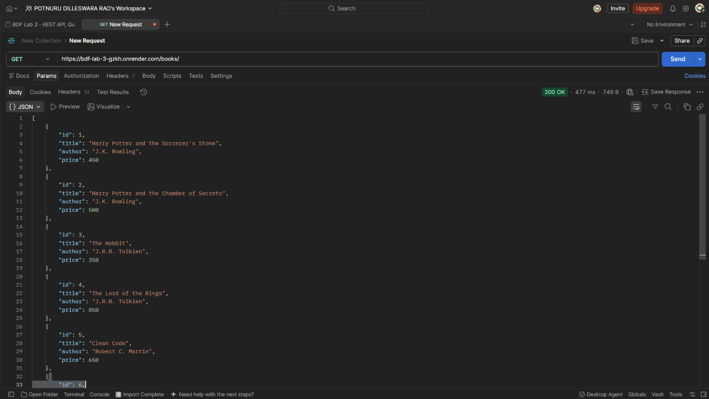

#### 02. Search Books by Title (`GET /books/?search_q=harry`)
- **Caption:** Filter books using partial title matching via SQL `LIKE` with parameterized wildcards (`200 OK`).
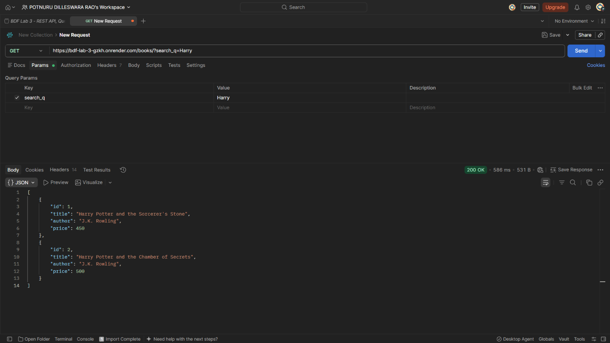

#### 03. Sort Ascending by Price (`GET /books/?order_by=price&order=ASC`)
- **Caption:** Sort books in ascending order based on the `price` column (`200 OK`).
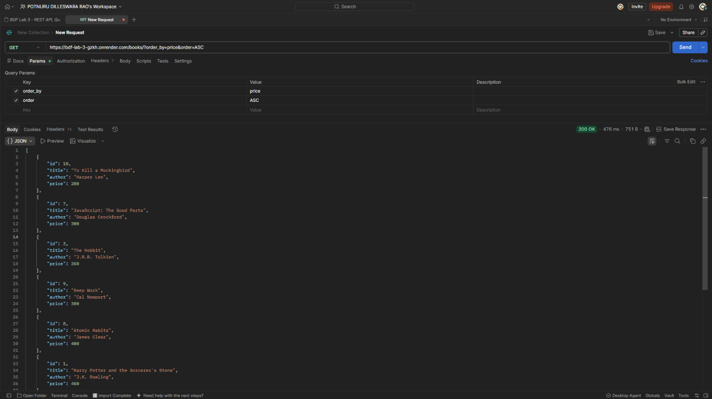

#### 04. Sort Descending by Price (`GET /books/?order_by=price&order=DESC`)
- **Caption:** Sort books in descending order based on the `price` column (`200 OK`).
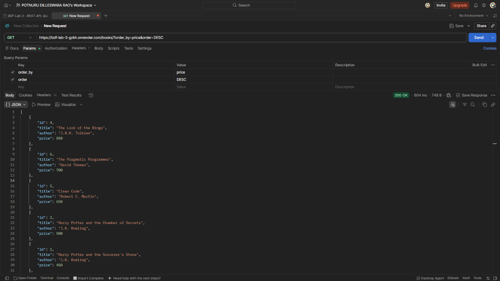

#### 05. Pagination with Limit and Offset (`GET /books/?limit=3&offset=3`)
- **Caption:** Paginate books using `limit` and `offset` parameters for seamless page navigation (`200 OK`).
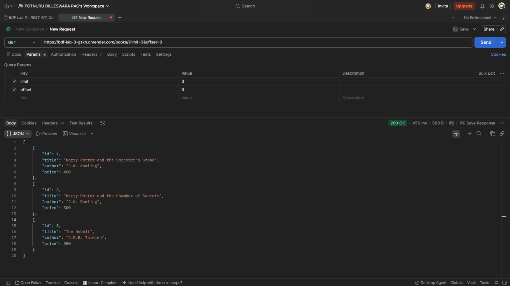

#### 06. Price Range Filter (`GET /books/?min_price=100&max_price=500`)
- **Caption:** Filter books within a specified price range using SQL comparison conditions (`200 OK`).
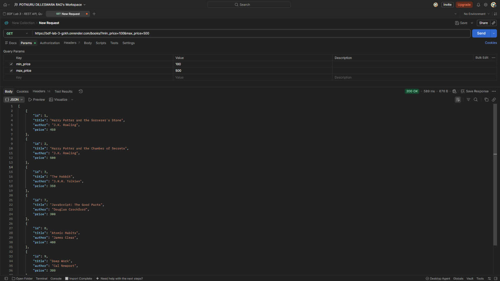

#### 07. Get Single Book by ID (`GET /books/1/`)
- **Caption:** Retrieve details of a specific book by its primary key ID (`200 OK`).
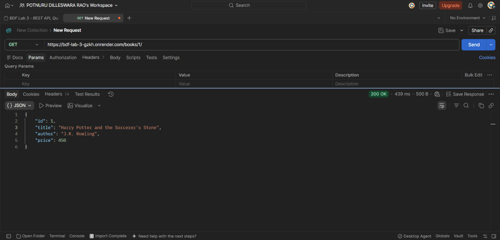

#### 08. Add New Book (`POST /books/`)
- **Caption:** Create a new book record with validated JSON payload (`201 Created`).
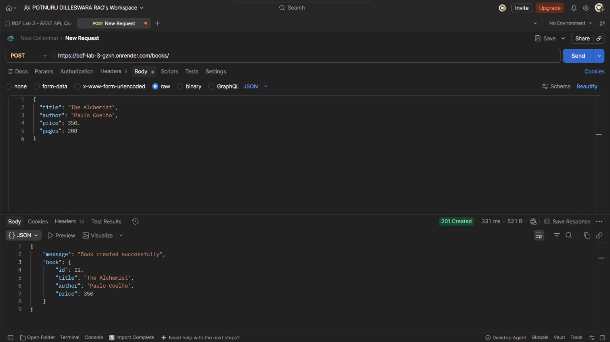

#### 09. Update Book by ID (`PUT /books/1/`)
- **Caption:** Update an existing book record in the database by its ID (`200 OK`).
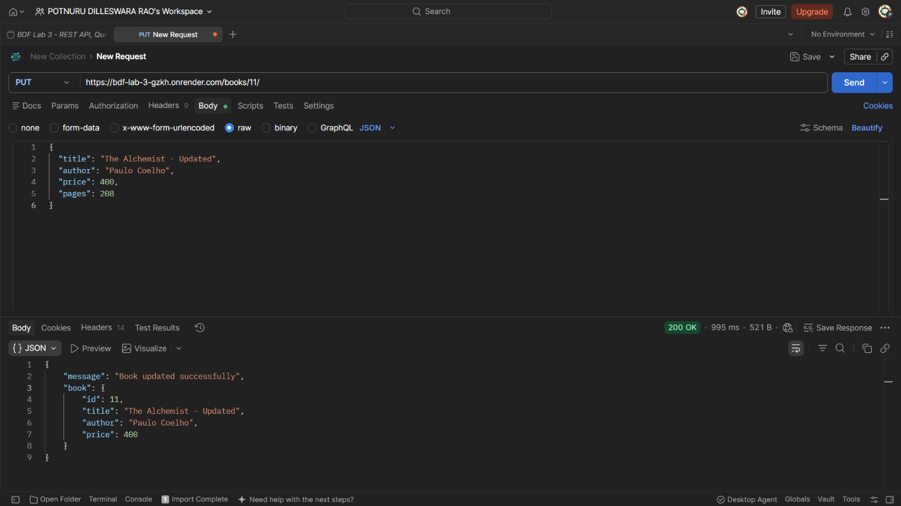

#### 10. Delete Book by ID (`DELETE /books/10/`)
- **Caption:** Delete a book record from the database by its ID (`200 OK`).
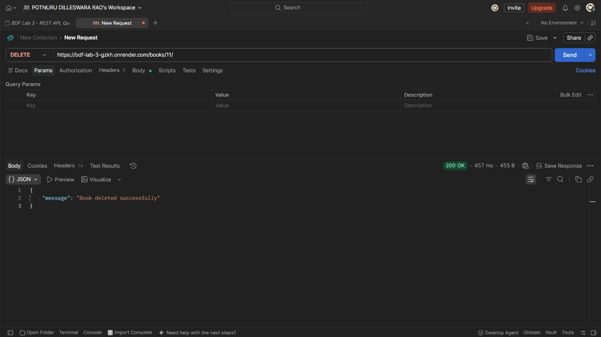

---

### 2. Failure Cases & Input Validation

#### 11. Validation: Missing Title (`POST /books/`)
- **Caption:** Reject book creation when the `title` field is omitted or empty (`400 Bad Request`).
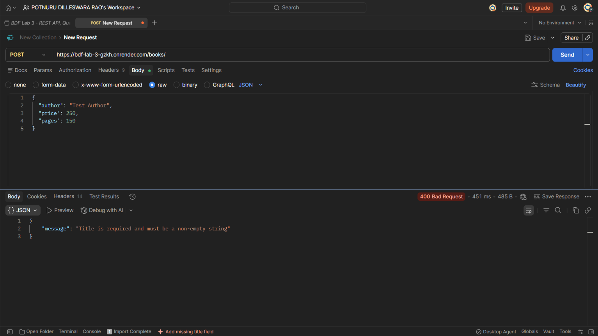

#### 12. Validation: Missing Author (`POST /books/`)
- **Caption:** Reject book creation when the `author` field is omitted or empty (`400 Bad Request`).
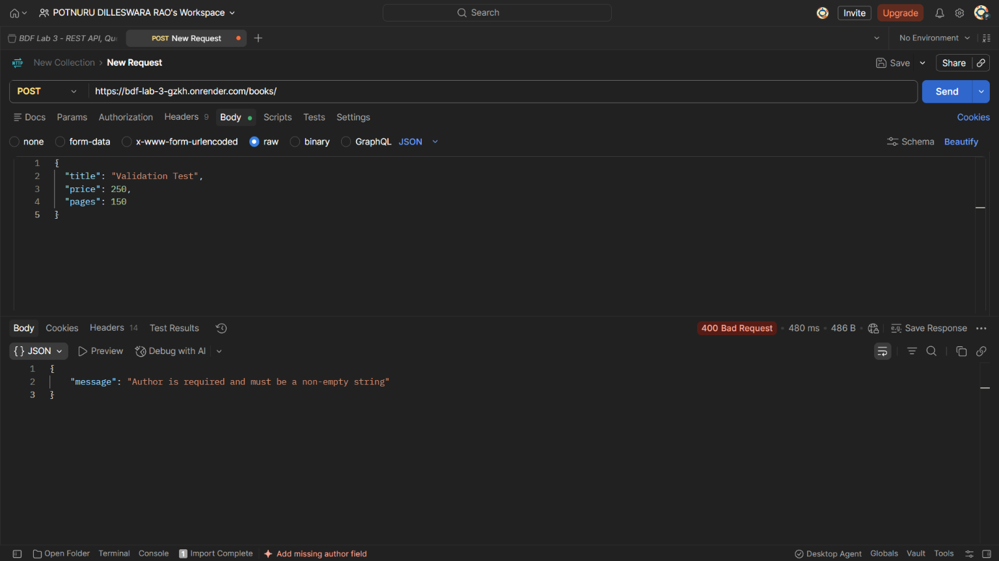

#### 13. Validation: Missing Price (`POST /books/`)
- **Caption:** Reject book creation when the `price` field is omitted (`400 Bad Request`).
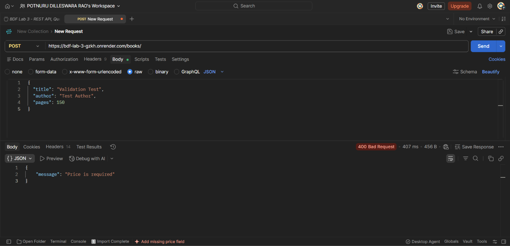

#### 14. Validation: Invalid / Non-Numeric Price (`POST /books/`)
- **Caption:** Reject book creation when `price` is non-numeric or negative (`400 Bad Request`).
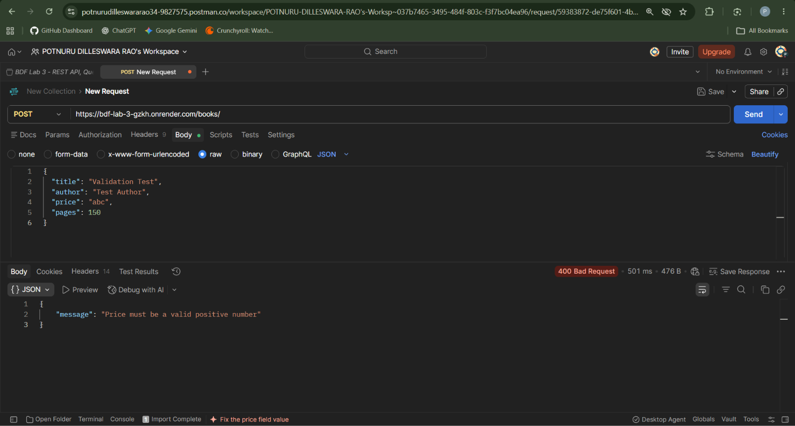

#### 15. Book Not Found (`GET /books/99999/`)
- **Caption:** Return not found error when requesting an ID that does not exist in the database (`404 Not Found`).
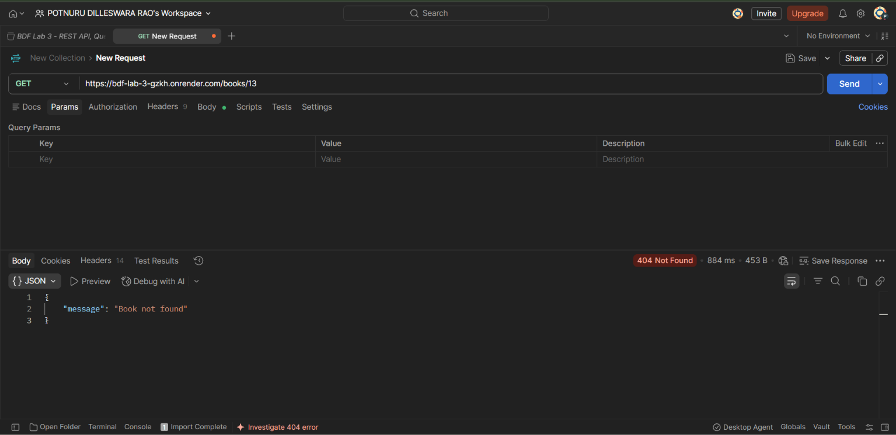

---

## Debugging Exercise
Detailed analysis, reproduction steps, code examples, and solutions for the 4 required debugging scenarios are provided in [DEBUGGING.md](DEBUGGING.md):
1. **Port conflict (`EADDRINUSE`)**
2. **Wrong import path (`MODULE_NOT_FOUND`)**
3. **Table-name typo (`no such table`)**
4. **Missing `await` with asynchronous database calls**

